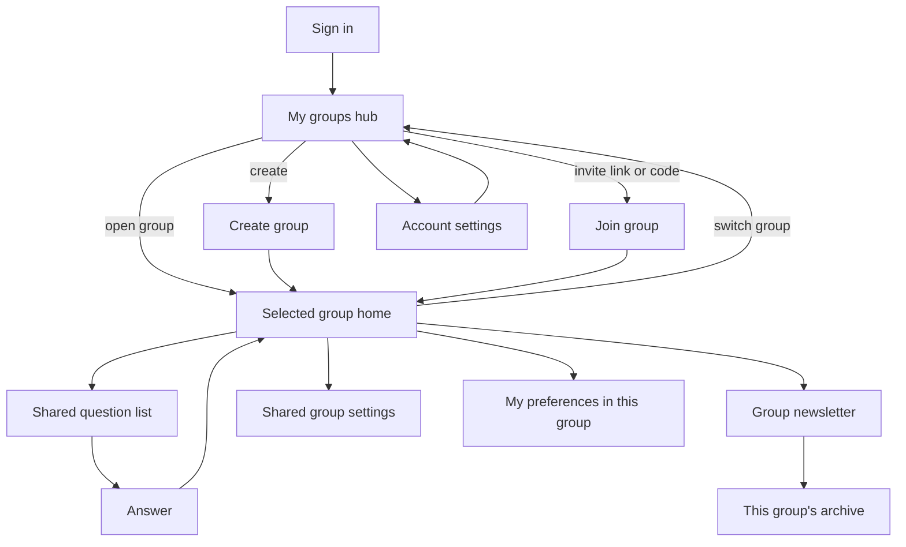
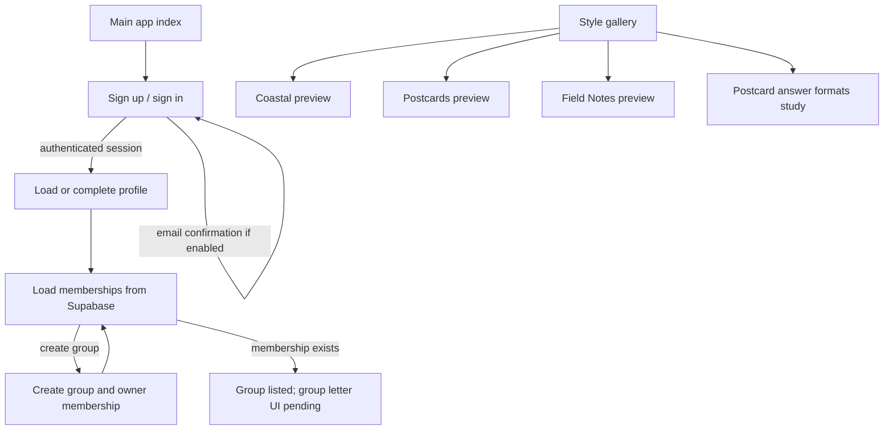
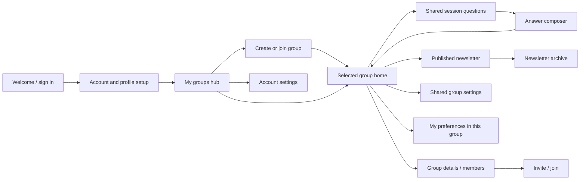

# Postmarked — product and page design

This document is the working source of truth for the app's screen map, user
flows, and design decisions. Update it when a page is added, a navigation
relationship changes, or a product decision is made. Keep implementation
status honest: a demo, a modal, and a planned page are different things.

## Product intent

Postmarked helps friends who live far apart stay close through shared
reflection prompts and a newsletter-like collection of their answers. The
experience should feel personal and editorial, work well on a phone, and keep
saved content independent from its presentation so the newsletter can be
restyled without changing what people wrote.

## Multi-group product model

One account can belong to any number of groups. After sign-in, the user's
landing page is **My groups**, not a preselected group's home. It shows the
groups the user has joined, each with its name, chosen style, latest
newsletter/session status, unanswered prompt count, and next activity date.
Primary actions are **Open group**, **Create group**, and **Join with invite**.
An account with no memberships sees a useful empty state with Create and Join
actions.

Opening a group enters that group's context. The group switcher in the group
header returns to My groups or opens a compact list of the user's other groups.
Choosing another group changes context; it does not merge questions, answers,
settings, or members. From then on, the same session, question, answer,
newsletter, and archive flow operates on the selected group. Deep links must
verify membership before showing group content.

The current `groups` and `group_members` schema represents many groups per
user: `group_members` has one row per `(group_id, user_id)`. The authenticated
entry reads and renders those memberships and lets a signed-in user create a
group; the visual group-home mockup remains a selected-group screen, not the
signed-in landing page.

### Three-person pilot flow

Pilot members create normal Supabase email/password accounts. Sign-up collects
a display name and stores it in the server-side profile for response
attribution. A shared group invite link can be opened before or after sign-up;
the user must be authenticated before the server validates the invite and adds
their membership. Never rely on a typed name or localStorage as identity or
authorization.

For the initial pilot, create one open 14-day newsletter/session and attach a
fixed app-provided question set to it. All group members see the same questions;
they submit and edit only their own text responses while the session is open.
Question authoring, question voting, and question setup by testers are out of
scope. Store the shared questions and responses in Supabase so attribution,
RLS, refresh, and cross-device access can be tested.

## Current user flow

Plain `/` or `index.html` is the authenticated app entry. The visual group and
newsletter prototype is isolated behind `?theme=...` and is used by the design
gallery and theme preview pages. The authenticated entry supports
sign-up/sign-in, profile completion, reading memberships, and creating a group
with owner membership. It does not yet accept invites or open real group
newsletters.

## Existing pages and destinations

| Page / URL | Purpose and current behavior | Links in / links out | Status |
| --- | --- | --- | --- |
| `index.html` | Real app entry: email/password sign-up/sign-in, profile setup, current user's group memberships, and group creation. Add `?theme=classic`, `?theme=coastal`, `?theme=postcard`, or `?theme=field-notes` for the isolated sample-content prototype. | Authenticated entry loads profile/groups and creates a group with owner membership. The theme prototype has in-page Home/Our letter, prompt jumps, composer, and Styles link to the gallery. | Auth/profile/group-list and group creation implemented; invites and real newsletter views are pending. |
| `styles.html` | Design comparison of three full-content themes. Each live preview is an `index.html?theme=...` iframe. Scroll position and Home/Our letter/question navigation are synchronized between previews. | Wordmark goes to `index.html`; Postcard formats goes to `postcard-formats.html`; each card opens `coastal.html`, `postcard.html`, or `field-notes.html`. | Implemented design study. |
| `coastal.html` | Standalone Coastline presentation; frames `index.html?theme=coastal`. | The embedded app's Styles link exits the frame to `styles.html`. | Implemented theme wrapper. |
| `postcard.html` | Standalone Postcards presentation; frames `index.html?theme=postcard`. | The embedded app's Styles link exits the frame to `styles.html`. | Implemented theme wrapper. |
| `field-notes.html` | Standalone Field Notes presentation; frames `index.html?theme=field-notes`. | The embedded app's Styles link exits the frame to `styles.html`. | Implemented theme wrapper. |
| `postcard-formats.html` | Compares three postcard answer layouts. Cards flip between an answer side and a decorative reverse; this is a visual study, not stored response content. | Wordmark goes to `index.html`; Back to style gallery goes to `styles.html`. | Implemented design study. |

The theme wrapper pages are presentation variants of one app page, not separate
product destinations. The gallery's message synchronization is restricted to
same-origin frames and only syncs navigation and scroll position.

### Link audit

Audited the relative `href`/`src` page, stylesheet, script, and iframe links on
2026-10-04 against the local preview server. Every local reference returned
HTTP 200, including the three preview query URLs. The GitHub Pages workflow
currently stages the three postcard-format study assets alongside the app and
theme pages.

Networked resources include Google Fonts and the browser Supabase SDK imported
from `esm.sh`; loading those features therefore needs network access. The app
uses the Supabase project URL and publishable key from `supabase-config.js`.

### Navigation and completeness notes

- The main app handles sign-up, sign-in, sign-out, profile setup, group
  membership reads, and authenticated group creation. Group/newsletter
  interactions currently exist only in the explicitly marked visual prototype.
- On the main app entry, memberships and group creation use Supabase. Invite
  acceptance and group/newsletter screens are not connected yet.
- Newsletter answers and group/member content in `?theme=...` previews are
  sample data. Preview responses and handwriting preferences are browser-local.
- The preview profile button opens account/auth, not a profile editor. The
  main app provides profile setup but not full account settings.
- The preview group switcher is inert; the main app lists memberships but
  cannot open or switch to a group's real content yet.
- The style gallery's preview cards are interactive iframes. Each embedded app
  can open its own dialogs and navigate between its in-page views.
- No dedicated routes/screens currently exist for creating or joining groups,
  group details, member profiles, question collection, session settings,
  archives, notifications, or image uploads.
- Email confirmation depends on Supabase Auth settings and allowed redirect
  URLs. Password recovery and a custom callback screen are not implemented.
- The app has no client-side router or browser history integration for its
  in-page views.

## Planned app information architecture

These are product screens to design and build, not pages that already exist.
Prefer mobile-first responsive screens with clear loading, empty, error, and
success states.

| ID | Screen | Purpose | Main entry | Main actions / next screens | MVP |
| --- | --- | --- | --- | --- | --- |
| P01 | Welcome / sign in | Explain the app and let returning users authenticate. | Signed-out launch or account action. | Sign in; create account; password recovery. | Pilot |
| P02 | Create account / confirm email | Register identity and guide email verification. | Welcome. | Confirm email; return to sign in/app. | Pilot |
| P03 | Profile setup | Choose account name and optional contact/location details. | First authenticated session. | Save profile; go to My groups or invited group. | Pilot |
| P04 | My groups hub | List every group the signed-in user belongs to, plus activity summaries. | Authenticated launch; group switcher. | Open/switch group; create group; join by invite; open account settings. | Yes |
| P05 | Create group | Create a private group with an 80-character name; its creator becomes owner and cadence defaults to 14 days. | My groups. | Create group; return to the group list. | Implemented |
| P06 | Join group / accept invite | Join a group using a validated shareable invite link or code. | My groups or invite link. | Sign in if needed; validate invite; accept; open that group's home. | Pilot |
| P07 | Group home | Show the selected group's open session, shared prompts, response progress, and members. | My groups or a group deep link. | Answer prompt; read newsletter; open archive, group settings, or personal group preferences. | Yes |
| P08 | Session questions | Show the fixed app-provided question set selected for the group session. | Selected group home/session card. | Read the shared prompts; answer them. Question authoring is out of pilot scope. | Pilot |
| P09 | Answer composer | Submit a response to a shared question; start with text. | Selected group home prompt or newsletter. | Save/edit allowed answer; return to this group's session. | Yes |
| P10 | Newsletter | Present this group's shared questions with attributed answers. | Group home / publication notice. | Read; respond if open; open this group's archive. | Yes |
| P11 | Newsletter archive | Browse past published newsletters for the selected group. | Group home or newsletter. | Open a past newsletter in the same group context. | Next |
| P12 | Member profile | Show a member's group-specific nickname, optional location/time zone, and contributions. | Member card or response attribution. | Return to this group/newsletter. | Next |
| P13 | Account settings | Manage identity, contact methods, global notification settings, and account actions. | My groups/profile control. | Save account settings; sign out; export/delete account. | Yes |
| P14 | Shared group settings | Manage the selected group's members, style, cadence, time zone, and group rules. | Group home/details; owner controls as appropriate. | Save shared settings; manage invitations/members; return to group. | Yes |
| P15 | My preferences in this group | Set the signed-in user's nickname, handwriting font, and notification overrides for one group. | Selected group home/menu. | Save personal group preferences without changing anyone else's settings. | Yes |
| P16 | Image answer composer | Add an optional image with accessible text response and upload state. | Answer composer. | Select/capture, preview, submit, retry/remove. | Later |
| P17 | Presentation preview | Preview available newsletter themes before changing the group's style. | Shared group settings. | Apply selected group theme; return to settings. | Later |

## Settings by scope

Settings should make ownership obvious. **Account settings** affect the person
everywhere; **My preferences in this group** affect only the current user's
experience in one group; **Shared group settings** affect everyone in that
group and should have role-based edit controls.

### Account settings — global to the user

- **Identity:** account display name, email address, password, and sign-in
  method. Changing email should require verification of the new address.
- **Phone:** optional phone number, verification status, and whether it may be
  used for account recovery or future invitations. Ask before SMS use; adding a
  number does not imply consent to import contacts.
- **Notifications — master control:** all notifications on/off.
- **Notification defaults:** new newsletter published, new question list
  available, and session reminders. These are the user's defaults across all
  groups.
- **Delivery/privacy:** enabled delivery channels (only those actually
  implemented), quiet hours/time zone, and notification preview privacy.
- **Account actions:** sign out, request data export, and delete account with
  clear consequences for authored content and group ownership.

### My preferences in this group — personal, per membership

- **Nickname in this group:** optional group-only name shown to fellow members;
  fall back to the account display name when blank.
- **Handwriting/font choice:** choose how this member's own newsletter answers
  are rendered in this group. This must be group-specific, not the current
  browser-global `localStorage` preference.
- **Notifications in this group:** override account defaults separately for
  new newsletters, new question lists, and reminders; offer per-group on/off
  controls without changing the user's other groups.
- **Optional profile visibility:** whether the user's location/time zone is
  shown to this group, if that privacy control is adopted.

### Shared group settings — applies to all members

- **Membership:** roster, roles/owner(s), invite link/code, invite revocation,
  member removal, and leaving the group.
- **Presentation:** group newsletter style (for example, Postcards, Coastline,
  Field Notes, or a new theme). This is separate from each member's font.
- **Cadence:** how often a question list opens and a newsletter is published.
  The agreed initial direction is every two weeks (14 days), which matches the
  current schema default. Keep the interval configurable, and define the
  group's time zone and release/close/publication times before automating it.
- **Schedule:** group time zone, question release/response deadlines, and
  publication time.
- **Group rules:** prompt submission/review, response visibility, unanswered
  questions, and whether sent newsletters can be edited or retracted.
- Only authorized group roles can edit shared settings. Personal membership
  preferences remain editable by that member regardless of group ownership.

### Notification precedence

Use the account master switch as a true kill switch. Account category choices
are the global defaults; a per-group choice may mute a category for that group
or inherit the account default. A group preference must never silently turn on
a category the user disabled globally. Store category keys consistently:
`newsletter_published`, `question_list_available`, and `session_reminder`.
If future group announcements are added, define them as a separate category.

## Data model implications

The currently applied schema provides `profiles.display_name`, one global
profile time zone, group-wide `groups.time_zone` and `groups.cadence_days`, and
the many-to-many membership relation. It does **not** yet store:

- account phone or notification defaults/preferences;
- a group-specific nickname or per-member font preference;
- per-group member notification overrides;
- the group's chosen newsletter theme.

The follow-on `create_group(text)` database function runs as the authenticated
user and creates the group and owner membership in one transaction, subject to
the existing RLS policies. It does not create a newsletter, seed prompts, or
invite other members; those are separate pilot steps.

The applied `cadence_days` default of 14 matches the agreed pilot cadence;
configurable schedule controls and automatic session creation still need app
work, but the pilot does not need a cadence migration. Display names must be
stored in the authenticated user's server-side profile, not solely in
localStorage. The preset questions must be attached to the group's newsletter
in the database so every member sees the same question IDs and responses can
reference them.

Do not edit the already-applied initial migration. Add a new migration when
implementing these settings: use Auth for verified email/phone credentials;
profile/app settings for account preferences; membership-keyed settings for
nickname/font/notification overrides; and a group field for shared theme.
Consider a dedicated JSON or relational preference table with validated
notification category keys rather than duplicating notification columns on
every feature table. Apply RLS so members can edit only their own per-group
preferences, while shared group fields remain owner/admin controlled.

### Intended core flow

## Design system and content model

- Keep the existing themes as presentation tokens/components. Avoid copying
  product behavior or sample content into each theme page.
- Treat a group, session/newsletter, question, response, and profile as data;
  render the same data through one reusable newsletter structure.
- Distinguish interaction states (open, submitted, published) with both text
  and visual treatment; do not rely on color alone.
- Design small screens first, then widen the content grid for tablet/desktop.
- Every screen should have a clear title, primary action, back/escape path, and
  empty/loading/error/success states appropriate to the operation.
- Image prompts/answers should be modeled as an optional response media type,
  with storage/retention/privacy rules designed before implementation.

## How to design and track changes

Use this Markdown file as the durable, version-controlled page inventory and
navigation contract. For visual exploration, keep HTML/CSS prototypes in the
repository (as the theme and postcard-format studies do); they are immediately
previewable on mobile and easy to review in a pull request. For higher-fidelity
collaboration, create frames in a visual design tool such as Figma, then link
the frame from the relevant page row here. Do not let a design-tool file replace
the text description of behavior, states, and navigation.

For each new screen:

1. Update the page table with its ID, purpose, entry, actions, and MVP status.
2. Sketch the route/flow and the loading, empty, error, success, and narrow
   viewport states before wiring it to real data.
3. Build or update a static prototype and check keyboard/mobile behavior.
4. Implement the route and persistence; update the page table and flow in the
   same change.
5. Verify every local link/asset and the end-to-end path; update
   `FEATURES.md` to mark delivered behavior.

Keep status markers consistent: **Implemented** means usable behavior exists;
**Design study** means a visual exploration, not a product workflow;
**Planned** means not built. Track prioritized implementation work in
`FEATURES.md`; use this file for page scope, purpose, and navigation.

## Decisions to make before building the full flow

- Should groups be created by any member, or only by an invited organizer?
- Can answers be seen as they arrive, or only when the newsletter is published?
- What happens to unanswered questions at publication?
- What group time zone and exact schedule define the 14-day session?
- Can published answers be edited or retracted?
- Is display location optional, and what profile details are visible to a group?
- Who chooses the newsletter theme: the group or each reader?
- What invite expiration and membership-removal rules are needed?
