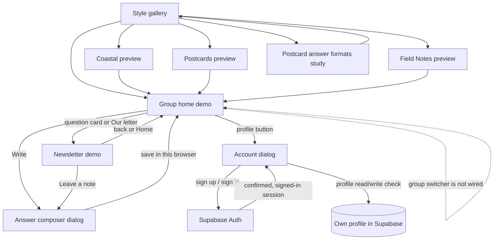
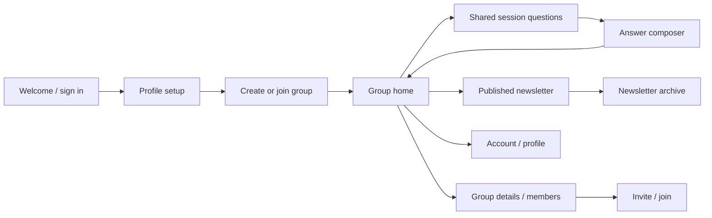

# Somewhere — product and page design

This document is the working source of truth for the app's screen map, user
flows, and design decisions. Update it when a page is added, a navigation
relationship changes, or a product decision is made. Keep implementation
status honest: a demo, a modal, and a planned page are different things.

## Product intent

Somewhere helps friends who live far apart stay close through shared
reflection prompts and a newsletter-like collection of their answers. The
experience should feel personal and editorial, work well on a phone, and keep
saved content independent from its presentation so the newsletter can be
restyled without changing what people wrote.

## Current user flow

The main app does not currently use URL routes for its home/newsletter views.
Those are in-page states. The account and answer composer are dialogs. Refreshing
or sharing a URL does not preserve the selected in-page view or question.

## Existing pages and destinations

| Page / URL | Purpose and current behavior | Links in / links out | Status |
| --- | --- | --- | --- |
| `index.html` | Main mobile-first app prototype: sample group home, weekly prompts, sample members, newsletter, local text composer, profile/account dialog. `?theme=classic` is the default; `?theme=coastal`, `?theme=postcard`, and `?theme=field-notes` change the presentation. | Styles opens `styles.html` in the top window. Home and Our letter switch in-page views; prompt cards jump to the matching newsletter question; Write opens the composer; profile opens auth. The wordmark `#` goes to the top of this document. | Implemented, with demo group/newsletter data. |
| `styles.html` | Design comparison of three full-content themes. Each live preview is an `index.html?theme=...` iframe. Scroll position and Home/Our letter/question navigation are synchronized between previews. | Wordmark goes to `index.html`; Postcard formats goes to `postcard-formats.html`; each card opens `coastal.html`, `postcard.html`, or `field-notes.html`. | Implemented design study. |
| `coastal.html` | Standalone Coastline presentation; frames `index.html?theme=coastal`. | The embedded app's Styles link exits the frame to `styles.html`. | Implemented theme wrapper. |
| `postcard.html` | Standalone Postcards presentation; frames `index.html?theme=postcard`. | The embedded app's Styles link exits the frame to `styles.html`. | Implemented theme wrapper. |
| `field-notes.html` | Standalone Field Notes presentation; frames `index.html?theme=field-notes`. | The embedded app's Styles link exits the frame to `styles.html`. | Implemented theme wrapper. |
| `postcard-formats.html` | Compares three postcard answer layouts. Cards flip between an answer side and a decorative reverse; this is a visual study, not stored response content. | Wordmark goes to `index.html`; Back to style gallery goes to `styles.html`. | Implemented design study. |

The theme wrapper pages are presentation variants of one app page, not separate
product destinations. The gallery's message synchronization is restricted to
same-origin frames and only syncs navigation and scroll position.

### Link audit

Audited the relative `href`/`src` page, stylesheet, script, and iframe links on
2026-10-04 against the local preview server. Every local reference returned
HTTP 200, including the three preview query URLs. The GitHub Pages workflow
currently stages the three postcard-format study assets alongside the app and
theme pages.

Networked resources include Google Fonts and the browser Supabase SDK imported
from `esm.sh`; loading those features therefore needs network access. The app
uses the Supabase project URL and publishable key from `supabase-config.js`.

### Navigation and completeness notes

- Home, Our letter, question jumps, answer composer, profile/account, sign-up,
  sign-in, sign-out, and the own-profile permission check have interactions.
- Newsletter answers and group/member data remain sample content. Submitted
  demo answers and the handwriting preference are browser-local only.
- The profile button opens account/auth, not a profile editor.
- The group switcher is currently an inert button; it does not select a group
  or show details/members.
- The style gallery's preview cards are interactive iframes. Each embedded app
  can open its own dialogs and navigate between its in-page views.
- No dedicated routes/screens currently exist for creating or joining groups,
  group details, member profiles, question collection, session settings,
  archives, notifications, or image uploads.
- Email confirmation depends on Supabase Auth settings and allowed redirect
  URLs. Password recovery and a custom callback screen are not implemented.
- The app has no client-side router or browser history integration for its
  in-page views.

## Planned app information architecture

These are product screens to design and build, not pages that already exist.
Prefer mobile-first responsive screens with clear loading, empty, error, and
success states.

| ID | Screen | Purpose | Main entry | Main actions / next screens | MVP |
| --- | --- | --- | --- | --- | --- |
| P01 | Welcome / sign in | Explain the app and let returning users authenticate. | Signed-out launch or account action. | Sign in; create account; password recovery. | Yes |
| P02 | Create account / confirm email | Register identity and guide email verification. | Welcome. | Confirm email; return to sign in/app. | Yes |
| P03 | Profile setup | Choose display name and optional location/time zone. | First authenticated session. | Save profile; create or join a group. | Yes |
| P04 | Group home | Show the current open session, shared prompts, response progress, and group members. | Authenticated launch / group switch. | Answer prompt; read current newsletter; open group details. | Yes |
| P05 | Create group | Create a private group and establish basic name/time zone/cadence. | No groups yet or group menu. | Create group; invite members; reach group home. | Yes |
| P06 | Join group / accept invite | Join a group using a shareable invite link or code. | Invite link or join action. | Preview group; accept; go to group home. | Yes |
| P07 | Group details and members | Explain membership and settings; provide safe group management. | Group home switcher or details action. | Invite, leave, remove member, edit permitted settings. | Yes |
| P08 | Session questions | Collect member-submitted prompts and show the shared set. | Group home/session card. | Add one question; review the final shared questions. | Yes |
| P09 | Answer composer | Submit a response to a shared question; start with text. | Group home prompt or newsletter. | Save/edit allowed draft; return to session. | Yes |
| P10 | Newsletter | Present each shared question with attributed group answers. | Group home / publication notice. | Read, respond if open, open archive. | Yes |
| P11 | Newsletter archive | Browse past published newsletters without modifying them. | Newsletter or group details. | Open a past newsletter. | Next |
| P12 | Member profile | Show member display name, optional location/time zone, and their group contributions. | Member card or response attribution. | Return to group/newsletter. | Next |
| P13 | Account and preferences | Edit profile, sign out, configure reminders/privacy, and manage account. | Profile control. | Save profile; notification/privacy options; deletion/export. | Yes |
| P14 | Image answer composer | Add an optional image with accessible text response and upload state. | Answer composer. | Select/capture, preview, submit, retry/remove. | Later |
| P15 | Presentation preferences | Choose a group's newsletter appearance without changing saved content. | Group settings. | Preview theme; save group style. | Later |

### Intended core flow

## Design system and content model

- Keep the existing themes as presentation tokens/components. Avoid copying
  product behavior or sample content into each theme page.
- Treat a group, session/newsletter, question, response, and profile as data;
  render the same data through one reusable newsletter structure.
- Distinguish interaction states (open, submitted, published) with both text
  and visual treatment; do not rely on color alone.
- Design small screens first, then widen the content grid for tablet/desktop.
- Every screen should have a clear title, primary action, back/escape path, and
  empty/loading/error/success states appropriate to the operation.
- Image prompts/answers should be modeled as an optional response media type,
  with storage/retention/privacy rules designed before implementation.

## How to design and track changes

Use this Markdown file as the durable, version-controlled page inventory and
navigation contract. For visual exploration, keep HTML/CSS prototypes in the
repository (as the theme and postcard-format studies do); they are immediately
previewable on mobile and easy to review in a pull request. For higher-fidelity
collaboration, create frames in a visual design tool such as Figma, then link
the frame from the relevant page row here. Do not let a design-tool file replace
the text description of behavior, states, and navigation.

For each new screen:

1. Update the page table with its ID, purpose, entry, actions, and MVP status.
2. Sketch the route/flow and the loading, empty, error, success, and narrow
   viewport states before wiring it to real data.
3. Build or update a static prototype and check keyboard/mobile behavior.
4. Implement the route and persistence; update the page table and flow in the
   same change.
5. Verify every local link/asset and the end-to-end path; update
   `FEATURES.md` to mark delivered behavior.

Keep status markers consistent: **Implemented** means usable behavior exists;
**Design study** means a visual exploration, not a product workflow;
**Planned** means not built. Track prioritized implementation work in
`FEATURES.md`; use this file for page scope, purpose, and navigation.

## Decisions to make before building the full flow

- Should groups be created by any member, or only by an invited organizer?
- Can answers be seen as they arrive, or only when the newsletter is published?
- What happens to unanswered questions at publication?
- What group time zone and exact schedule define the 14-day session?
- Can published answers be edited or retracted?
- Is display location optional, and what profile details are visible to a group?
- Who chooses the newsletter theme: the group or each reader?
- What invite expiration and membership-removal rules are needed?
